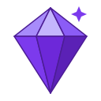
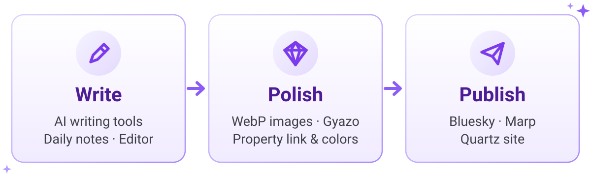

<p align="center">
  <picture>
    <source media="(prefers-color-scheme: dark)" srcset="docs/assets/logo-dark.svg">
    <source media="(prefers-color-scheme: light)" srcset="docs/assets/logo-light.svg">
    
  </picture>
</p>

<h1 align="center">Crystal</h1>

<p align="center"><b>書く・整える・発信する。すべてを Obsidian から。</b></p>

<p align="center">
  <a href="https://github.com/masaki39/obsidian-crystal/releases/latest"></a>
  <a href="https://github.com/masaki39/obsidian-crystal/releases"></a>
  <a href="LICENSE"></a>
  
</p>

<p align="center"><a href="README.md">English</a> | <b>日本語</b></p>

<p align="center">
  <picture>
    <source media="(prefers-color-scheme: dark)" srcset="docs/assets/hero-dark.svg">
    <source media="(prefers-color-scheme: light)" srcset="docs/assets/hero-light.svg">
    
  </picture>
</p>

Crystal は、書きかけのメモから人に見せる成果物までの流れをまとめて扱う Obsidian プラグインです。主な機能は次のとおりです。

- AI による執筆支援
- デイリーノートとエディターのツール
- 軽量な画像処理
- Bluesky・Marp スライド・Quartz サイトへのワンコマンド発信

> [!NOTE]
> - Crystal はデスクトップ専用です。
> - 一部の機能には外部サービスや CLI ツールが必要です。[要件](#要件)を参照してください。
> - 個人用のツールキットとして始まりましたが、どなたでも自由に使えます。

## ハイライト

小さな例をひとつ紹介します。**Auto Sort Tasks** をオンにすると、タスクにチェックを入れるたびにデイリーノートが自動で整います。

```markdown
<!-- Before -->
- [ ] Write README
- [x] Fix build
- [x] Review PR
```

```markdown
<!-- After -->
- [x] Fix build
- [x] Review PR
- [ ] Write README
```

### ✍️ 書く

- 🤖 **AI 執筆ツール**: 翻訳、校正、独自の指示によるリライト、description の生成ができます。OpenAI、Gemini、完全ローカルの Ollama に対応しています。→ [AI](docs/ja/ai.md)
- 📅 **デイリーノート**: 日付間の移動、タスクの追加、タイムラインへの投稿、下書きノートでの執筆ができ、必要に応じて自動ソートや自動リンクも行えます。→ [デイリーノート](docs/ja/daily-notes.md)
- ⌨️ **エディター**: Cosense 風の自動箇条書き、タイムスタンプ付きノート、リンクツール、OGP リンクカード、ルールに基づくファイル整理を提供します。→ [エディター](docs/ja/editor.md)

### 💎 整える

- 🖼️ **画像**: 貼り付けやドロップした画像を軽量な WebP ファイルにします。複数の画像を一度に貼り付けることもできます。→ [画像](docs/ja/images.md)
- ☁️ **Gyazo**: 画像をアップロードしたり、ノート内の画像をまとめて Gyazo に移したりできます。→ [Gyazo](docs/ja/gyazo.md)
- 🔗 **プロパティリンク**: `next` ↔ `previous` のように、frontmatter のプロパティ間のリンクを双方向に保ちます。→ [プロパティリンク](docs/ja/property-link.md)
- 🎨 **プロパティカラー**: 重要なプロパティ名に専用の色を付けます。→ [プロパティカラー](docs/ja/property-colors.md)

### 🚀 発信する

- 🦋 **Bluesky**: 画像やリンクカード付きで投稿し、各投稿をデイリーノートに残せます。→ [Bluesky](docs/ja/bluesky.md)
- 🎞️ **Marp**: スライドを PPTX、PDF、HTML に書き出し、ライブプレビューし、エディター内のツールバーで移動できます。→ [Marp](docs/ja/marp.md)
- 🌐 **Quartz**: Quartz サイトの同期と表示をワンコマンドで行えます。→ [Quartz](docs/ja/quartz.md)

### 🧰 その他

- 🎮 **ゲーミフィケーション**: 完了したタスクに応じて XP、レベル、ストリーク、バッジが得られます。→ [ゲーミフィケーション](docs/ja/gamification.md)
- 🪟 **ワークスペース**: ウィンドウの不透明度の切り替え、ペイン間やサイドバーへ移動できるフォーカスコマンド、ステータスバーの並べ替えを提供します。→ [ワークスペース](docs/ja/workspace.md)
- 💻 **ハッカーモード**: CRT オーバーレイや起動シーケンスなど、見た目だけのターミナル風エフェクトです。→ [ハッカーモード](docs/ja/hacker-mode.md)

## クイックスタート

1. [BRAT](https://github.com/TfTHacker/obsidian42-brat) をインストールして有効にします。
2. BRAT の設定で **Add Beta plugin** を選択し、`https://github.com/masaki39/obsidian-crystal` を入力します。
3. **Settings → Community plugins** で **Crystal** を有効にします。
4. 設定不要の機能を試してみましょう。
   - スクリーンショットをノートに貼り付けます。WebP として保存されます。
   - 行頭でスペースを入力します。箇条書きになります。
   - **Daily: Open today's note** を実行します。コアプラグインの **Daily notes** が必要です。
5. AI を使うには、**Settings → Crystal → AI** を開いて **AI Provider** を選びます。API キーを貼り付けるか Ollama を準備して、**Verify** を選択します。そのあとテキストを選択して **AI: Translate selected text** を実行します。

## 要件

Crystal はデスクトップ版 Obsidian 1.11.4 以降で動作します。ほとんどの機能はそのまま使えます。次の機能には追加のものが必要です。

| 機能 | 必要なもの |
|---|---|
| AI | OpenAI または Gemini の API キー、またはローカルの [Ollama](https://ollama.com/) サーバー |
| AI: Generate git commit summary | git リポジトリになっている Vault、シェルで使える `git`、コアプラグインの **Daily notes** |
| デイリーノート、ゲーミフィケーション | コアプラグインの **Daily notes** |
| Gyazo | Gyazo のアクセストークン |
| Bluesky | `bsky.social` の Bluesky アカウントとアプリパスワード |
| Marp | [Marp CLI](https://github.com/marp-team/marp-cli)。PDF と PPTX には Chrome、Edge、Chromium のいずれかも必要 |
| Quartz | ローカルの [Quartz](https://quartz.jzhao.xyz/) リポジトリと Node.js（`npx`） |
| ゲーミフィケーションの執筆目標 | **Collect Stats** をオンにした [Better Word Count](https://github.com/lukeleppan/better-word-count)（任意） |

CLI を使う機能（Marp、Quartz、git サマリー）はログインシェル経由で実行され、macOS で動作確認しています。

## ネットワーク利用とプライバシー

Crystal にテレメトリはありません。外部サービスに接続するのは、それを必要とする機能を使ったときだけです。

| 機能 | サービス | 送信される内容 | タイミング |
|---|---|---|---|
| AI（OpenAI） | `api.openai.com` | コマンドが処理するテキスト（選択範囲、1 行、ノート全体、またはその日の git diff） | AI コマンドを実行したとき |
| AI（Gemini） | Google Gemini API | 同上 | 同上 |
| AI（Ollama） | 自分の Ollama サーバー（**Ollama Base URL**、デフォルトは `localhost:11434`） | 同上。サーバーが手元のマシンで動いていれば、データはマシンの外に出ません | 同上 |
| AI の **Verify** ボタン | 確認するキーのプロバイダー | API キーのみ（Ollama はサーバーへの問い合わせのみ）。モデル一覧を取得するだけで、ノートのテキストは送りません | **Verify** を選択したとき |
| Gyazo | `upload.gyazo.com`、`api.gyazo.com` | 画像ファイルとアクセストークン。アップロードした画像は URL を知っている人なら誰でも見られます | Gyazo コマンドを実行したとき、または **Verify** を選択したとき。さらにトークンが設定されていると、Bluesky の投稿ウィンドウで添付した画像は、投稿がデイリーノートのタイムラインに追記される場合に送信時にアップロードされます。**Post to daily note timeline** では常に、**Post to Bluesky** ではタイムライン追記がオンのときだけです |
| Bluesky | `bsky.social` | ハンドルとアプリパスワード（サインイン用）、投稿のテキストと画像 | 投稿したとき、または **Verify** を選択したとき |
| Bluesky のリンクカード | リンク先の Web サイト | ページとプレビュー画像の取得リクエスト | 投稿に URL があり、画像がないとき |
| リモート画像 | 画像のホスト | ダウンロードリクエスト | **Gyazo: Replace image URLs in active note** を実行したとき、または画像 URL を埋め込んだ下書きを投稿したとき |
| OGP リンクカード | `ogpf.vercel.app` | 入力した URL | カードを含むノートが表示されるたび |
| Quartz | Quartz リポジトリ経由で GitHub。`npx` が npm レジストリにアクセスする場合もあります | `npx quartz sync` がプッシュする内容 | Quartz の同期コマンドを実行したとき。開く系のコマンドは `<user>.github.io` と GitHub Actions のページをブラウザで開きます |

認証情報は Obsidian のシークレットストレージに保存されます。Marp CLI、git、Quartz は手元のマシン上で実行されます。

## ドキュメント

- 📚 [ドキュメント索引](docs/ja/README.md): すべての機能、コマンド、自動で動く機能の一覧です。
- 📝 [変更履歴](changelog/): バージョンごとのリリースノートです。

## 関連プラグイン

以下は Crystal の中で生まれ、現在は独立したリポジトリで開発されています。

- [Tab Swap](https://github.com/masaki39/tab-swap)
- [Daily Notes Timeline](https://github.com/masaki39/daily-notes-timeline): Crystal が書き込む `[!timeline]` コールアウトにスタイルを付けます

## 開発

```bash
pnpm install
pnpm run dev     # watch build
pnpm run build   # type-check and production build
pnpm test
```

ビルドを試すには、`main.js`、`manifest.json`、`styles.css` を `<Vault>/.obsidian/plugins/obsidian-crystal/` にコピーして Obsidian を再読み込みします。

## ライセンス

[MIT](LICENSE) © masaki39
