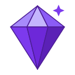
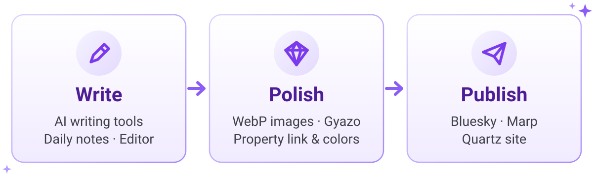

<p align="center">
  <picture>
    <source media="(prefers-color-scheme: dark)" srcset="docs/assets/logo-dark.svg">
    <source media="(prefers-color-scheme: light)" srcset="docs/assets/logo-light.svg">
    
  </picture>
</p>

<h1 align="center">Crystal</h1>

<p align="center"><b>Write, polish, and publish — all from Obsidian.</b></p>

<p align="center">
  <a href="https://github.com/masaki39/obsidian-crystal/releases/latest"></a>
  <a href="https://github.com/masaki39/obsidian-crystal/releases"></a>
  <a href="LICENSE"></a>
  
</p>

<p align="center"><b>English</b> | <a href="README.ja.md">日本語</a></p>

<p align="center">
  <picture>
    <source media="(prefers-color-scheme: dark)" srcset="docs/assets/hero-dark.svg">
    <source media="(prefers-color-scheme: light)" srcset="docs/assets/hero-light.svg">
    
  </picture>
</p>

Crystal is an Obsidian plugin for the whole path from a rough note to something you share. It covers:

- AI help with writing
- daily notes and editor tools
- lightweight image handling
- one-command publishing to Bluesky, Marp slides, and a Quartz site

> [!NOTE]
> - Crystal is desktop only.
> - Some features need an external service or CLI tool; see [Requirements](#requirements).
> - It began as a personal toolkit — anyone is welcome to use it.

## Highlights

Here's a small taste. With **Auto Sort Tasks** turned on, a daily note tidies itself as you check things off:

```markdown
<!-- Before -->
- [ ] Write README
- [x] Fix build
- [x] Review PR
```

```markdown
<!-- After -->
- [x] Fix build
- [x] Review PR
- [ ] Write README
```

### ✍️ Write

- 🤖 **AI writing tools**: translate, proofread, rewrite with your own instructions, and generate descriptions. Works with OpenAI, Gemini, or a fully local Ollama. → [AI](docs/en/ai.md)
- 📅 **Daily notes**: jump between days, add tasks, post to a timeline, write in a draft note, and optionally sort and link automatically. → [Daily notes](docs/en/daily-notes.md)
- ⌨️ **Editor**: Cosense-style auto bullets, timestamped notes, link tools, OGP link cards, and rule-based file organizing. → [Editor](docs/en/editor.md)

### 💎 Polish

- 🖼️ **Images**: pasted and dropped images become compact WebP files, and you can paste many images at once. → [Images](docs/en/images.md)
- ☁️ **Gyazo**: upload images, or move a note's images to Gyazo in one step. → [Gyazo](docs/en/gyazo.md)
- 🔗 **Property link**: keep links between frontmatter properties two-way, like `next` ↔ `previous`. → [Property link](docs/en/property-link.md)
- 🎨 **Property colors**: give important property names their own color. → [Property colors](docs/en/property-colors.md)

### 🚀 Publish

- 🦋 **Bluesky**: post with images and link cards, and keep each post in your daily note. → [Bluesky](docs/en/bluesky.md)
- 🎞️ **Marp**: export slides to PPTX, PDF, or HTML, preview them live, and navigate with an in-editor toolbar. → [Marp](docs/en/marp.md)
- 🌐 **Quartz**: sync and open your Quartz site with one command. → [Quartz](docs/en/quartz.md)

### 🧰 Extras

- 🎮 **Gamification**: XP, levels, streaks, and badges for the tasks you finish. → [Gamification](docs/en/gamification.md)
- 🪟 **Workspace**: toggle window opacity, focus commands that move between panes and into the sidebars, and status bar ordering. → [Workspace](docs/en/workspace.md)
- 💻 **Hacker mode**: purely cosmetic terminal effects like a CRT overlay and a boot sequence. → [Hacker mode](docs/en/hacker-mode.md)

## Quick start

1. Install [BRAT](https://github.com/TfTHacker/obsidian42-brat) and enable it.
2. In BRAT's settings, select **Add Beta plugin** and enter `https://github.com/masaki39/obsidian-crystal`.
3. Enable **Crystal** in **Settings → Community plugins**.
4. Try a feature that needs no setup:
   - Paste a screenshot into a note. It's saved as WebP.
   - Type a space at the start of a line. It becomes a bullet.
   - Run **Daily: Open today's note**. This needs the core **Daily notes** plugin.
5. For AI, open **Settings → Crystal → AI** and choose an **AI Provider**. Paste its API key, or set up Ollama, and select **Verify**. Then select some text and run **AI: Translate selected text**.

## Requirements

Crystal runs on desktop Obsidian 1.11.4 or later. Most features work out of the box. These need something extra:

| Feature | Needs |
|---|---|
| AI | An OpenAI or Gemini API key, or a local [Ollama](https://ollama.com/) server |
| AI: Generate git commit summary | A vault that is a git repository, `git` in your shell, and the core **Daily notes** plugin |
| Daily notes, Gamification | The core **Daily notes** plugin |
| Gyazo | A Gyazo access token |
| Bluesky | A Bluesky account on `bsky.social` and an app password |
| Marp | [Marp CLI](https://github.com/marp-team/marp-cli), plus Chrome, Edge, or Chromium for PDF and PPTX |
| Quartz | A local [Quartz](https://quartz.jzhao.xyz/) repository and Node.js (`npx`) |
| Gamification writing goal | [Better Word Count](https://github.com/lukeleppan/better-word-count) with **Collect Stats** on (optional) |

The CLI-based features (Marp, Quartz, git summary) run through your login shell and are tested on macOS.

## Network use & privacy

Crystal has no telemetry. It contacts a service only when you use a feature that needs one:

| Feature | Service | What is sent | When |
|---|---|---|---|
| AI with OpenAI | `api.openai.com` | The text the command works on: the selection, a line, the whole note, or the day's git diff | When you run an AI command |
| AI with Gemini | Google Gemini API | Same as above | Same as above |
| AI with Ollama | Your Ollama server (**Ollama Base URL**, default `localhost:11434`) | Same as above. Nothing leaves your machine if the server runs on your machine | Same as above |
| AI **Verify** buttons | The provider whose key you're verifying | Only the API key (or a request to the Ollama server), to list models. No note text | When you select **Verify** |
| Gyazo | `upload.gyazo.com`, `api.gyazo.com` | Image files and your access token. Uploaded images are public to anyone with the URL | When you run a Gyazo command or select **Verify**. Also, while a token is set, images attached in a Bluesky post window are uploaded when you submit, if the post goes to the daily note timeline: always in **Post to daily note timeline**, and in **Post to Bluesky** only while timeline appending is on |
| Bluesky | `bsky.social` | Your handle and app password (to sign in), and the post's text and images | When you post or select **Verify** |
| Bluesky link cards | The linked website | A request for the page and its preview image | When a post has a URL and no images |
| Remote images | The image's host | A download request | When you run **Gyazo: Replace image URLs in active note**, or post a draft that embeds image URLs |
| OGP link cards | `ogpf.vercel.app` | The URL you entered | Every time a note containing the card is displayed |
| Quartz | GitHub, through your Quartz repository; `npx` may also contact the npm registry | Whatever `npx quartz sync` pushes | When you run a Quartz sync command. The open commands open `<user>.github.io` and the GitHub Actions page in your browser |

Credentials are kept in Obsidian's secret storage. Marp CLI, git, and Quartz run locally on your machine.

## Documentation

- 📚 [Documentation index](docs/en/README.md): every feature, command, and automatic behavior.
- 📝 [Changelog](changelog/): release notes for each version.

## Related plugins

These started inside Crystal and now live in their own repositories:

- [Tab Swap](https://github.com/masaki39/tab-swap)
- [Daily Notes Timeline](https://github.com/masaki39/daily-notes-timeline): styles the `[!timeline]` callouts that Crystal writes

## Development

```bash
pnpm install
pnpm run dev     # watch build
pnpm run build   # type-check and production build
pnpm test
```

To try a build, copy `main.js`, `manifest.json`, and `styles.css` to `<Vault>/.obsidian/plugins/obsidian-crystal/` and reload Obsidian.

## License

[MIT](LICENSE) © masaki39
