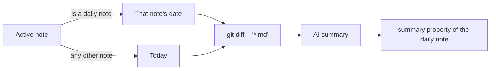

**English** | [日本語](../ja/ai.md)

# AI

Translate, proofread, rewrite, and summarize notes with OpenAI, Gemini, or a local Ollama model. Every AI command uses the provider you pick in settings.

[← Back to the documentation index](README.md)

## Requirements

You need one of these:

- **OpenAI**: an [OpenAI API key](https://platform.openai.com/api-keys).
- **Gemini**: a [Gemini API key](https://aistudio.google.com/api-keys).
- **Ollama**: [Ollama](https://ollama.com/) running on your machine with at least one model pulled.

**AI: Generate git commit summary** also needs:

- a vault that is a git repository
- `git` on your login shell's `PATH`
- the core **Daily notes** plugin

## Quick setup

1. Open **Settings → Crystal → AI**.
2. Choose an **AI Provider**.
3. Do one of the following:
   - **OpenAI or Gemini**: paste the API key and select **Verify**.
   - **Ollama**: run `ollama serve` and `ollama pull llama3.1`, then set **Ollama Base URL** and **Ollama Model** and select **Verify**.
4. Select some text and run **AI: Translate selected text** from the command palette.

## Commands

| Command | What it does |
|---|---|
| `AI: Translate selected text` | Translates the selection (Japanese ↔ English) and replaces it with the result. |
| `AI: Translate above cursor text` | Translates the line above the cursor and inserts the result at the cursor. |
| `AI: Translate below cursor text` | Translates the line below the cursor and inserts the result at the cursor. |
| `AI: Grammar check current line` | Proofreads the current line in its own language and replaces it with the corrected text. |
| `AI: Rewrite (replace selection or whole note)` | Asks for an instruction, then rewrites the selection (or the whole note if nothing is selected) and replaces it. |
| `AI: Rewrite (append result at end)` | Asks for an instruction, reads the selection (or the whole note), and appends newly generated Markdown at the end of the note. |
| `AI: Generate description for current file` | Writes a one-sentence, search-friendly `description` into the note's frontmatter. |
| `AI: Generate git commit summary` | Summarizes the day's git diff of `.md` files and writes it to the `summary` property of the daily note. |

## Settings

| Setting | Default | Description |
|---|---|---|
| **AI Provider** | OpenAI | Which provider every AI command uses: OpenAI, Gemini, or Ollama (local). |
| **OpenAI API Key** | (empty) | Stored in Obsidian's secret storage. **Verify** checks that it works. |
| **OpenAI Model** | `gpt-4o-mini` | Also available: `gpt-5`, `gpt-5-mini`, `gpt-5-nano`, `gpt-4.1`, `gpt-4.1-mini`, `gpt-4o`. |
| **Gemini API Key** | (empty) | Stored in Obsidian's secret storage. **Verify** checks that it works. |
| **Gemini Model** | `gemini-flash-latest` | Also available: `gemini-flash-lite-latest`, `gemini-2.5-flash`, `gemini-2.5-flash-lite`, `gemini-2.0-flash`, `gemini-2.0-flash-lite`, `gemma-4-31b-it`, `gemma-4-26b-a4b-it`. |
| **Ollama Base URL** | `http://localhost:11434` | URL of your local Ollama server. |
| **Ollama Model** | `llama3.1` | Name of a model you already pulled with `ollama pull`. |

## Examples

**AI: Translate selected text**

```markdown
今日は新しいプラグインを公開しました。
```

becomes

```markdown
I released a new plugin today.
```

**AI: Rewrite (replace selection or whole note)** with the instruction "Summarize as bullet points":

```markdown
We met on Monday to plan the release. The docs need an update, and the build has to pass on CI before we tag it.
```

becomes

```markdown
- Met on Monday to plan the release
- Update the docs
- Make sure CI passes before tagging
```

How **AI: Generate git commit summary** picks the date and the note:



## Notes and troubleshooting

- **Output language is fixed.**
  - Translation always goes between Japanese and English.
  - **Generate description** and **Generate git commit summary** always write in Japanese.
  - The grammar check keeps the language of the input.
- **Privacy.**
  - OpenAI and Gemini receive the text a command works on. That's the selection, the line, or the whole note; for the git summary, it's the diff.
  - With Ollama, everything stays on your machine.
  - See [Network use & privacy](../../README.md#network-use--privacy).
- **"AI is not configured"**: the selected provider has no API key, or Ollama has no base URL or model. Check **Settings → Crystal → AI**.
- **Ollama errors**: make sure `ollama serve` is running and the model name matches `ollama list`.
- **"No diff found" / "No commits found"**: the vault has no `.md` changes for that day, or it isn't a git repository.
