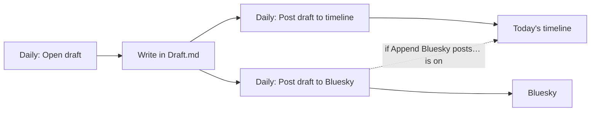

**English** | [日本語](../ja/daily-notes.md)

# Daily notes

Move between daily notes, capture tasks and quick posts, and optionally keep each note tidy automatically. Crystal builds on Obsidian's core **Daily notes** plugin and uses its folder and date format.

[← Back to the documentation index](README.md)

## Requirements

- The core **Daily notes** plugin, enabled. Its folder and date format decide where notes are created.
- Optional: [Daily Notes Timeline](https://github.com/masaki39/daily-notes-timeline) styles the `[!timeline]` callouts that the timeline commands write.

## Quick setup

1. Enable **Settings → Core plugins → Daily notes** and set its folder and date format.
2. Run **Daily: Open today's note**.
3. Optional: turn on **Auto Sort Tasks** or **Auto Link Notes** in **Settings → Crystal → Daily notes**. Both are off by default.

## Commands

| Command | What it does |
|---|---|
| `Daily: Open today's note` | Opens today's daily note and creates it if needed. |
| `Daily: Open yesterday's note` | Opens the day before the active daily note (or before today). |
| `Daily: Open tomorrow's note` | Opens the day after the active daily note (or after today). |
| `Daily: Add task to daily note` | Asks for a task and adds `- [ ] task` to today's note, above the timeline heading. |
| `Daily: Roll over yesterday's undone tasks` | Moves the open tasks (`- [ ]`) out of the previous day's note and inserts them at the cursor. |
| `Daily: Open draft` | Opens the draft note (**Draft note path**) in a tab and creates it if needed. |
| `Daily: Post draft to timeline` | Adds the draft's text to today's timeline as a callout, then empties the draft. Frontmatter is kept. |
| `Daily: Post draft to Bluesky` | Posts the draft to Bluesky with up to 4 embedded images, then empties the draft. See [Bluesky](bluesky.md). |
| `Bluesky: Post to daily note timeline` | Opens a small editor and adds what you write to today's timeline. See [Bluesky](bluesky.md). |

## Settings

**Settings → Crystal → Daily notes**

| Setting | Default | Description |
|---|---|---|
| **Auto Sort Tasks** | Off | Each time a daily note changes, sorts every list block above the timeline heading: completed tasks first, then open tasks, then other bullets. Nested lines move with their parent, and a checked parent stays with the open tasks until all of its nested tasks are checked. |
| **Auto Link Notes** | Off | When you create a note anywhere in the vault, adds `- HH:mm [[note]]` to today's daily note. The line is removed again if the note is deleted. Restart Obsidian after changing this setting. |
| **Newest First (Daily Notes)** | Off | Adds new tasks, links, and timeline entries at the top instead of the bottom. With **Auto Sort Tasks**, open tasks come before completed ones. |
| **Show weekday after inline title** | On | Shows the weekday next to a daily note's inline title. This is display only; the note isn't changed. |
| **Weekday format** | `dddd` | moment.js format for the weekday label (for example `ddd` or `(ddd)`). Follows Obsidian's language. |
| **Draft note path** | `Draft.md` | The note used by the draft commands. `.md` is added if missing. |

**Settings → Crystal → Bluesky**

| Setting | Default | Description |
|---|---|---|
| **Daily Note timeline heading** | `# Time Line` | The heading that marks the timeline section. It must match the line exactly. |

## Examples

What the timeline commands write (the heading is added if it's missing):

```markdown
# Time Line

> [!timeline] 09:12
> Shipped the docs update.

> [!timeline|blue] 12:40
> Posted to Bluesky 🦋
```

**Auto Sort Tasks**: an edit to

```markdown
- [ ] Write README
- [x] Fix build
- Idea: logo
- [x] Review PR
```

turns it into

```markdown
- [x] Fix build
- [x] Review PR
- [ ] Write README
- Idea: logo
```

The draft workflow:



## Notes and troubleshooting

- **"Daily Notes plugin is disabled."**: enable the core **Daily notes** plugin.
- **Auto Link Notes adds links for notes you didn't create by hand**: it reacts to every new `.md` file, including ones made by templates or other plugins. Turn it off if that's noisy.
- **Auto Link Notes doesn't add a link**: the link goes into today's note only if that note already exists. The setting is read at startup, so restart after changing it.
- **The timeline gets added in the wrong place**: **Daily Note timeline heading** has to match the heading line exactly, including the `#` characters.
- **Posting a draft didn't empty it**: if you edit the draft while it's being posted, Crystal keeps it so nothing is lost.
