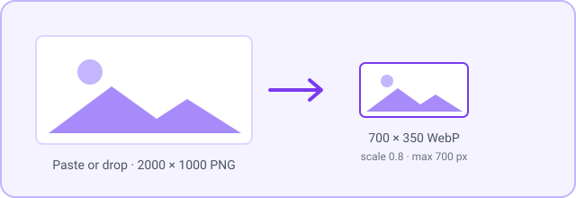
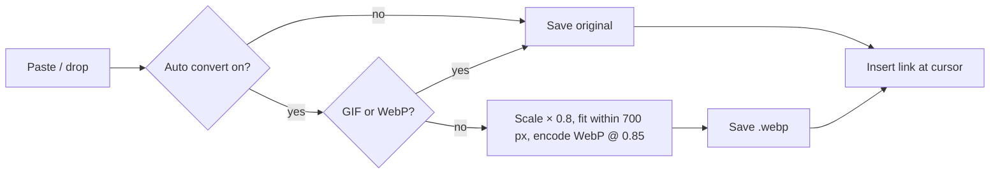

**English** | [日本語](../ja/images.md)

# Images

Pasted and dropped images are saved as compact WebP files in your attachment folder, so your vault stays small. You can also paste many images from disk at once.

[← Back to the documentation index](README.md)

## Requirements

- No external tools. Conversion runs locally in Obsidian.

## Quick setup

1. Paste a screenshot into a note. With the defaults it's saved as WebP, scaled to 80%, and capped at 700 px.
2. If you want sharper images, raise **Image Default Resize Scale** and **Image Max Size** in **Settings → Crystal → Images**.
3. To keep the original files instead, turn off **Auto Convert Images to WebP on Paste**.

## Commands

| Command | What it does |
|---|---|
| `Image: Paste multiple images from file system` | Pick several images in a file dialog. They're saved to the attachment folder (converted to WebP if conversion is on) and inserted at the cursor as `![[…]]` links, one per line. |

This runs automatically:

- **Paste and drop**: images you paste or drop into the editor are saved to the attachment folder and linked at the cursor. If **Auto Convert Images to WebP on Paste** is on, they're converted first.

## Settings

**Settings → Crystal → Images**

| Setting | Default | Description |
|---|---|---|
| **Auto Convert Images to WebP on Paste** | On | Converts pasted, dropped, and multi-pasted images to WebP. The same conversion is applied before uploading to [Gyazo](gyazo.md). |
| **WebP Compression Quality** | 0.85 | 0.1 gives the smallest files, 1.0 the best quality. |
| **Image Default Resize Scale** | 0.8 | Scales each image before saving (1.0 = 100%). |
| **Image Max Size** | 700 | Longest side in pixels after scaling. Larger images are shrunk to fit. |

## Examples

How the size is calculated: a 2000 × 1000 screenshot at scale 0.8 becomes 1600 × 800. That's over the 700 px limit, so it's shrunk to 700 × 350.

## Notes and troubleshooting

- **The original image isn't kept.** Only the converted WebP is saved.
- **Text in screenshots looks blurry**: raise **Image Max Size** (for example to 1920) and set **Image Default Resize Scale** to 1.0.
- **GIFs are never converted**, so animations keep working.
- Images go to the folder set in Obsidian's **Settings → Files and links → Default location for new attachments**.
- Crystal handles paste and drop for the whole window. If another image plugin also handles paste, turn one of them off.
- **Rich text with no plain-text version**: if the clipboard holds only HTML (no plain text), Crystal pastes it as plain text.
- **Dropping several images at once**: only the first image is handled. Use **Image: Paste multiple images from file system** for batches.
