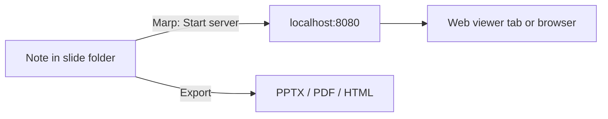

**English** | [日本語](../ja/marp.md)

# Marp

Write slides in Markdown and turn them into PPTX, PDF, or HTML with [Marp](https://marp.app/). A live preview server, an in-editor toolbar, and slide navigation commands are included.

[← Back to the documentation index](README.md)

## Requirements

- **Marp CLI**, installed globally so that `marp` works in your login shell:
  - `npm i -g @marp-team/marp-cli`, or
  - `pnpm add -g @marp-team/marp-cli`
- **Chrome, Edge, or Chromium**, for PDF and PPTX export.
- **macOS or Linux** are recommended. Crystal runs CLI tools through your login shell.
- Optional: the core **Web viewer** plugin. With it, the preview server opens inside Obsidian and cursor sync works.

## Quick setup

1. Install Marp CLI and check that `marp -v` works in a terminal.
2. In **Settings → Crystal → Marp**, set **Marp Slide Folder Path (relative path)**, for example `Slides`.
3. Open a note in that folder that starts with `marp: true` in its frontmatter.
4. Run **Marp: Start server**, or select the play button on the floating toolbar.

## Commands

| Command | What it does |
|---|---|
| `Marp: Create slide from current note` | Creates a Marp slide note in **Marp Slide Folder Path (relative path)** (or next to the current note if that is empty) and opens it in a new tab. The file name and frontmatter come from the **New slide from note** settings. The two notes are linked to each other through properties. |
| `Marp: Preview slide` | Runs `marp -p` to open the Marp preview. A `marp-preview.html` file is written next to the note. |
| `Marp: Export slide (PPTX)` | Exports a PPTX file. |
| `Marp: Export slide (PPTX editable)` | Exports a PPTX file with editable text. |
| `Marp: Export slide (HTML)` | Exports a single HTML file. |
| `Marp: Export slide (HTML folder with attachments)` | Exports a folder containing the HTML, a copy of the Markdown, and the local images, with links rewritten as relative paths. You can move or share the folder as is. |
| `Marp: Export slide (PDF)` | Exports a PDF file. |
| `Marp: Export presenter notes` | Writes the presenter notes to `<note>-notes.txt`. |
| `Marp: Start server` | Starts a Marp server for the slide folder at `http://localhost:8080` and opens the current slide (in a Web viewer tab, or your browser). Crystal watches the server and tells you if it stops. |
| `Marp: Stop server` | Stops the server. |
| `Marp: Go to next slide` | Moves the cursor to the next slide. |
| `Marp: Go to previous slide` | Moves the cursor to the previous slide. |
| `Marp: Move slide down` | Swaps the current slide with the next one. |
| `Marp: Move slide up` | Swaps the current slide with the previous one. |
| `Marp: Move images to Marp folder` | Moves the images used in the note into **Marp Attachment Folder Path** and updates the links. |
| `Marp: Move images and convert links to relative paths` | Runs **Move images to Marp folder**, then **Editor: Convert links to relative paths**. |

Exports go to **Export Folder Path** (**Settings → Crystal → General**). If that's empty, they're saved next to the note.

## Settings

**Settings → Crystal → Marp**

| Setting | Default | Description |
|---|---|---|
| **Marp Slide Folder Path (relative path)** | (empty) | Folder that holds your slides. The server and the toolbar need it. |
| **Marp Theme Directory** | (empty) | Directory passed to `marp --theme-set`. Absolute or relative path. |
| **Marp Attachment Folder Path** | (empty) | Where **Move images to Marp folder** puts images. |
| **Show slide toolbar** | On | Shows floating buttons in notes inside the slide folder: previous/next slide, move slide up/down, export to PPTX/PDF, start/stop server. |
| **Move preview slide to cursor** | Off | The server preview follows the editor cursor. Needs the **Web viewer** core plugin. |
| **Move cursor to preview slide** | Off | The editor cursor follows the slide shown in the server preview. Needs the **Web viewer** core plugin. |

**New slide from note**:

| Setting | Default | Description |
|---|---|---|
| **File name prefix** | (empty) | Text at the start of the new file name. |
| **Date format** | `YYYY-MM-DD` | moment.js format for the date in the file name. Leave empty to omit the date. |
| **Separator** | ` ` (space) | Text between the date and the title. |
| **Title source** | File name | **File name**, or **First alias**, which falls back to the file name. Used in the file name, the title slide, and the header. |
| **Theme** | (empty) | `theme` property of the new slide. Leave empty to omit it. |
| **Paginate** | On | Adds `paginate: true`. |
| **Header** | (empty) | `header` property. Supports `{{title}}`, `{{date}}`, and `{{date:YYYY/MM/DD}}`. |
| **Parent note property** | `slide` | Property on the current note that gets a link to the slide. Leave empty to skip it. |
| **Slide property** | `parents` | Property on the slide that gets a link back to the parent note. Leave empty to skip it. |

**Settings → Crystal → General**

| Setting | Default | Description |
|---|---|---|
| **Export Folder Path** | (empty) | Where exports are saved. If it's empty, they go next to the note. |

## Examples

**Marp: Create slide from current note**, run on `Project kickoff.md` with the defaults, creates `2026-11-10 Project kickoff.md` (links follow your Obsidian link format):

```markdown
---
marp: true
paginate: true
parents:
  - "[[Project kickoff]]"
---

# Project kickoff
```

At the same time, `slide: ["[[2026-11-10 Project kickoff]]"]` is added to `Project kickoff.md`.



## Notes and troubleshooting

- **"marp: command not found"**: Crystal runs commands in your login shell (`$SHELL`, or `zsh` if that isn't set). Make sure `marp` is on that shell's `PATH`.
- **Export fails for PDF/PPTX**: install Chrome, Edge, or Chromium.
- **Port 8080 is in use**:
  - The server always uses port 8080.
  - If another Marp server already answers there, Crystal reuses it.
  - **Stop server** only stops a process on port 8080 if it's Marp.
- **The toolbar doesn't appear**: set **Marp Slide Folder Path (relative path)** and open a note inside that folder.
- **Windows** isn't well supported, because the CLI features rely on a Unix-style shell.
