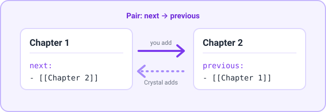

**English** | [日本語](../ja/property-link.md)

# Property link

Keep links between notes two-way. For example, when `next` in note A links to note B, Crystal adds a link back to A in B's `previous` property. It only adds links: nothing is ever removed or overwritten.

[← Back to the documentation index](README.md)

## Requirements

- None. The feature is off by default.

## Quick setup

1. In **Settings → Crystal → Property link**, turn on **Enable Property Link**.
2. Select **Add New Pair**, then enter `next` as the source and `previous` as the target.
3. In a note, add `next: ["[[Another note]]"]`. `Another note` then gets `previous: ["[[This note]]"]`.

## Commands

| Command | What it does |
|---|---|
| `Property link: Sync current note` | Checks the active note against every pair and adds any missing links on the other side. |
| `Property link: Sync all notes` | Does the same for every Markdown note in the vault. |

This runs automatically while the feature is on:

- Whenever a note's metadata changes, its pairs are synced.

## Settings

**Settings → Crystal → Property link**

| Setting | Default | Description |
|---|---|---|
| **Enable Property Link** | Off | Syncs pairs automatically when notes change. If the target property doesn't exist, it's created as a list. |
| **Add New Pair** | — | Adds a pair row. |
| **Pair *n*** | — | **Source** is the property to watch and **Target** is the property to fill on the linked note. Select **-** to remove the pair. |

## Examples



| Pair | Relation |
|---|---|
| `next` → `previous` | Directed. To also sync from `previous` to `next`, add the reverse pair as a separate row. |
| `friends` → `friends` | Symmetric. Both notes list each other. |

`Chapter 1.md`:

```yaml
next:
  - "[[Chapter 2]]"
```

After saving, `Chapter 2.md` gets:

```yaml
previous:
  - "[[Chapter 1]]"
```

## Notes and troubleshooting

- **Links that don't resolve are skipped.** That includes links to notes that don't exist yet.
- **Removing a link isn't mirrored.** If you delete `next: [[Chapter 2]]`, the `previous` link in Chapter 2 stays until you remove it yourself. Running the sync commands won't remove it either.
- Only list properties are read and written. Existing values are kept, and duplicates aren't added.
