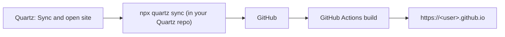

**English** | [日本語](../ja/quartz.md)

# Quartz

Publish your [Quartz](https://quartz.jzhao.xyz/) site from Obsidian. One command runs `npx quartz sync` in your local Quartz repository and opens the site.

[← Back to the documentation index](README.md)

## Requirements

- A local clone of Quartz that's already set up to deploy with `npx quartz sync`.
- Node.js, so that `npx` works in your login shell.
- A GitHub Pages **user site** at `https://<user>.github.io`. The open commands build this URL from your GitHub user name.

## Quick setup

1. Set up Quartz by following its [documentation](https://quartz.jzhao.xyz/) and check that `npx quartz sync` works in a terminal.
2. In **Settings → Crystal → Quartz**, set:
   - **Path to Local Repository of Quartz** (absolute path)
   - **Quartz Site Name**
   - **Github User Name**
3. Restart Obsidian so the command names show the site name.
4. Run **Quartz: Sync and open site (…)**.

## Commands

| Command | What it does |
|---|---|
| `Quartz: Sync` | Runs `cd "<Quartz path>" && npx quartz sync`. |
| `Quartz: Open site (<site name>)` | Opens `https://<user>.github.io` in your browser. |
| `Quartz: Sync and open site (<site name>)` | Syncs, then opens the site and the repository's GitHub Actions page. |

## Settings

**Settings → Crystal → Quartz**

| Setting | Default | Description |
|---|---|---|
| **Path to Local Repository of Quartz** | (empty) | Absolute path to your Quartz repository. |
| **Quartz Site Name** | (empty) | Shown in the command names. Restart Obsidian after changing it. |
| **Github User Name** | (empty) | Used to build `https://<user>.github.io` and the Actions URL. |

## Examples

## Notes and troubleshooting

- **Missing settings stop the command.**
  - If **Path to Local Repository of Quartz** is empty, the sync commands show "Quartz path is not set" and do nothing.
  - If **Github User Name** is empty, the open commands show "GitHub user name is not set" and do nothing. **Quartz: Sync and open site** checks both before syncing.
- **Sync failures**:
  - If `npx quartz sync` exits with an error, "Quartz sync failed (exit code …)" appears and no pages are opened.
  - The output is written to the developer console. You can also run the sync in a terminal to see errors.
  - A successful sync only means the push worked. Check the GitHub Actions page to see whether the site build passed.
- **Project pages and custom domains** (anything other than `<user>.github.io`) aren't supported by the open commands.
- **The command names show `()`**: set **Quartz Site Name** and restart Obsidian.
