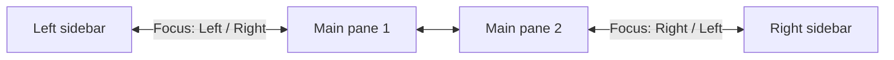

**English** | [日本語](../ja/workspace.md)

# Workspace

Tools for the Obsidian window itself: a translucent window you can toggle, focus commands that move between panes and into the sidebars, and a status bar you can reorder or trim.

[← Back to the documentation index](README.md)

## Requirements

- Desktop Obsidian. Window opacity uses the desktop window API.

## Quick setup

1. Set **Window opacity** in **Settings → Crystal → General**, for example to 0.9.
2. Assign hotkeys to **Window: Toggle opacity**, **Focus: Left**, and **Focus: Right**.
3. Optional: arrange the status bar in **Settings → Crystal → Status bar**.

## Commands

| Command | What it does |
|---|---|
| `Window: Toggle opacity` | Switches between fully opaque (1.0) and your last translucent value (0.9 the first time). |
| `Focus: Left` | Moves focus to the pane on the left. At the edge of the main area, it continues into the left sidebar. From the right sidebar, it goes back to the main area. |
| `Focus: Right` | The same, toward the right. |

## Settings

**Settings → Crystal → General**

| Setting | Default | Description |
|---|---|---|
| **Window opacity** | 1.0 | Opacity of the Obsidian window, from 0.5 to 1.0. It's reset to 1.0 when the plugin is disabled. |

**Settings → Crystal → Status bar**

| Setting | Default | Description |
|---|---|---|
| Item list | (unchanged) | Every status bar item that's been detected, including items from other plugins and core features. Use **↑**/**↓** to reorder an item and the eye button to hide or show it. |
| **Rescan** | — | Looks for status bar items again, for example after another plugin loads. |
| **Reset to default** | — | Clears your order and hidden items. |

## Examples

How focus moves:

## Notes and troubleshooting

- **A status bar item is missing from the list**:
  - Items only show up once the plugin that owns them has loaded. Open the vault fully, then select **Rescan**.
  - Items that are already hidden somewhere else (by their own plugin, a core setting, or a CSS snippet) can't be detected.
- **An item says "not loaded"**: it was saved in your order, but its plugin isn't loaded right now.
- Window opacity has no effect on mobile.
