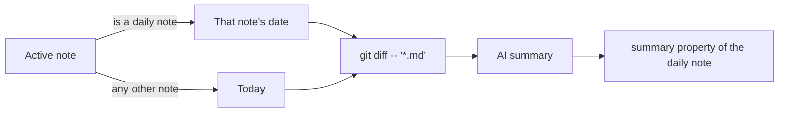

[English](../en/ai.md) | **日本語**

# AI

OpenAI、Gemini、またはローカルの Ollama モデルを使って、ノートの翻訳、校正、リライト、要約を行います。すべての AI コマンドは、設定で選んだプロバイダーを使います。

[← ドキュメント索引に戻る](README.md)

## 要件

次のいずれかが必要です。

- **OpenAI**: [OpenAI API キー](https://platform.openai.com/api-keys)。
- **Gemini**: [Gemini API キー](https://aistudio.google.com/api-keys)。
- **Ollama**: 手元のマシンで動作し、モデルを 1 つ以上 pull 済みの [Ollama](https://ollama.com/)。

**AI: Generate git commit summary** には、さらに次のものが必要です。

- git リポジトリになっている Vault
- ログインシェルの `PATH` 上にある `git`
- コアプラグインの **Daily notes**

## クイックセットアップ

1. **Settings → Crystal → AI** を開きます。
2. **AI Provider** を選びます。
3. 次のいずれかを行います。
   - **OpenAI または Gemini**: API キーを貼り付けて **Verify** を選択します。
   - **Ollama**: `ollama serve` と `ollama pull llama3.1` を実行し、**Ollama Base URL** と **Ollama Model** を設定して **Verify** を選択します。
4. テキストを選択し、コマンドパレットから **AI: Translate selected text** を実行します。

## コマンド

| コマンド | 動作 |
|---|---|
| `AI: Translate selected text` | 選択範囲を翻訳（日本語 ↔ 英語）し、結果で置き換えます。 |
| `AI: Translate above cursor text` | カーソルの上の行を翻訳し、結果をカーソル位置に挿入します。 |
| `AI: Translate below cursor text` | カーソルの下の行を翻訳し、結果をカーソル位置に挿入します。 |
| `AI: Grammar check current line` | 現在の行をその言語のまま校正し、修正後のテキストで置き換えます。 |
| `AI: Rewrite (replace selection or whole note)` | 指示を入力させたうえで、選択範囲（何も選択していなければノート全体）をリライトして置き換えます。 |
| `AI: Rewrite (append result at end)` | 指示を入力させたうえで、選択範囲（またはノート全体）を読み込み、新しく生成した Markdown をノートの末尾に追記します。 |
| `AI: Generate description for current file` | 検索しやすい 1 文の `description` をノートの frontmatter に書き込みます。 |
| `AI: Generate git commit summary` | その日の `.md` ファイルの git diff を要約し、デイリーノートの `summary` プロパティに書き込みます。 |

## 設定

| 設定 | デフォルト | 説明 |
|---|---|---|
| **AI Provider** | OpenAI | すべての AI コマンドが使うプロバイダー。OpenAI、Gemini、Ollama（ローカル）から選びます。 |
| **OpenAI API Key** | （空） | Obsidian のシークレットストレージに保存されます。**Verify** で動作を確認できます。 |
| **OpenAI Model** | `gpt-4o-mini` | ほかに `gpt-5`、`gpt-5-mini`、`gpt-5-nano`、`gpt-4.1`、`gpt-4.1-mini`、`gpt-4o` を選べます。 |
| **Gemini API Key** | （空） | Obsidian のシークレットストレージに保存されます。**Verify** で動作を確認できます。 |
| **Gemini Model** | `gemini-flash-latest` | ほかに `gemini-flash-lite-latest`、`gemini-2.5-flash`、`gemini-2.5-flash-lite`、`gemini-2.0-flash`、`gemini-2.0-flash-lite`、`gemma-4-31b-it`、`gemma-4-26b-a4b-it` を選べます。 |
| **Ollama Base URL** | `http://localhost:11434` | ローカルの Ollama サーバーの URL。 |
| **Ollama Model** | `llama3.1` | `ollama pull` で取得済みのモデル名。 |

## 使用例

**AI: Translate selected text**

```markdown
今日は新しいプラグインを公開しました。
```

は次のようになります。

```markdown
I released a new plugin today.
```

**AI: Rewrite (replace selection or whole note)** に「Summarize as bullet points」（箇条書きで要約して）と指示した場合:

```markdown
We met on Monday to plan the release. The docs need an update, and the build has to pass on CI before we tag it.
```

は次のようになります。

```markdown
- Met on Monday to plan the release
- Update the docs
- Make sure CI passes before tagging
```

**AI: Generate git commit summary** が日付とノートを決める流れ:



## 注意とトラブルシューティング

- **出力言語は固定です。**
  - 翻訳は常に日本語と英語の間で行われます。
  - **Generate description** と **Generate git commit summary** は常に日本語で書きます。
  - 文法チェックは入力の言語を保ちます。
- **プライバシー。**
  - OpenAI と Gemini には、コマンドが処理するテキストが送信されます。選択範囲、行、またはノート全体で、git サマリーの場合は diff です。
  - Ollama なら、すべてが手元のマシン内で完結します。
  - [ネットワーク利用とプライバシー](../../README.ja.md#ネットワーク利用とプライバシー)を参照してください。
- **"AI is not configured"**（AI が設定されていません）: 選択したプロバイダーの API キーがないか、Ollama のベース URL またはモデルが未設定です。**Settings → Crystal → AI** を確認してください。
- **Ollama のエラー**: `ollama serve` が動作していること、モデル名が `ollama list` と一致していることを確認してください。
- **"No diff found" / "No commits found"**（diff / コミットが見つかりません）: その日に Vault の `.md` の変更がないか、Vault が git リポジトリではありません。
