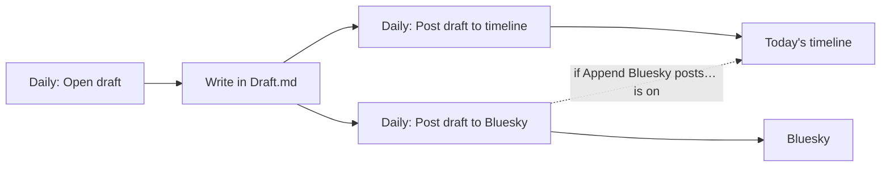

[English](../en/daily-notes.md) | **日本語**

# デイリーノート

デイリーノート間を移動し、タスクや短い投稿を記録し、必要に応じて各ノートを自動で整理します。Crystal は Obsidian のコアプラグイン **Daily notes** を土台にしており、そのフォルダーと日付形式を使います。

[← ドキュメント索引に戻る](README.md)

## 要件

- コアプラグイン **Daily notes**（有効にしておく必要があります）。そのフォルダーと日付形式によって、ノートの作成場所が決まります。
- 任意: [Daily Notes Timeline](https://github.com/masaki39/daily-notes-timeline) を使うと、タイムラインのコマンドが書き込む `[!timeline]` コールアウトにスタイルが付きます。

## クイックセットアップ

1. **Settings → Core plugins → Daily notes** を有効にし、フォルダーと日付形式を設定します。
2. **Daily: Open today's note** を実行します。
3. 任意: **Settings → Crystal → Daily notes** で **Auto Sort Tasks** や **Auto Link Notes** をオンにします。どちらもデフォルトではオフです。

## コマンド

| コマンド | 動作 |
|---|---|
| `Daily: Open today's note` | 今日のデイリーノートを開きます。なければ作成します。 |
| `Daily: Open yesterday's note` | アクティブなデイリーノート（または今日）の前日のノートを開きます。 |
| `Daily: Open tomorrow's note` | アクティブなデイリーノート（または今日）の翌日のノートを開きます。 |
| `Daily: Add task to daily note` | タスクを入力させ、今日のノートのタイムライン見出しの上に `- [ ] task` を追加します。 |
| `Daily: Roll over yesterday's undone tasks` | 前日のノートから未完了のタスク（`- [ ]`）を移動し、カーソル位置に挿入します。 |
| `Daily: Open draft` | 下書きノート（**Draft note path**）をタブで開きます。なければ作成します。 |
| `Daily: Post draft to timeline` | 下書きのテキストを今日のタイムラインにコールアウトとして追加し、下書きを空にします。frontmatter は残ります。 |
| `Daily: Post draft to Bluesky` | 下書きを、埋め込まれた画像（最大 4 枚）とともに Bluesky に投稿し、下書きを空にします。[Bluesky](bluesky.md) を参照してください。 |
| `Bluesky: Post to daily note timeline` | 小さなエディターを開き、書いた内容を今日のタイムラインに追加します。[Bluesky](bluesky.md) を参照してください。 |

## 設定

**Settings → Crystal → Daily notes**

| 設定 | デフォルト | 説明 |
|---|---|---|
| **Auto Sort Tasks** | オフ | デイリーノートが変更されるたびに、タイムライン見出しより上にあるすべてのリストブロックを並べ替えます。完了したタスク、未完了のタスク、その他の箇条書きの順になります。ネストされた行は親と一緒に移動します。チェック済みの親でも、ネストされたタスクがすべて完了するまでは未完了の側に残ります。 |
| **Auto Link Notes** | オフ | Vault 内のどこかでノートを作成すると、今日のデイリーノートに `- HH:mm [[note]]` を追加します。そのノートが削除されると、行も削除されます。この設定を変更したら Obsidian を再起動してください。 |
| **Newest First (Daily Notes)** | オフ | 新しいタスク、リンク、タイムラインの項目を、末尾ではなく先頭に追加します。**Auto Sort Tasks** と併用すると、未完了のタスクが完了したタスクより前に来ます。 |
| **Show weekday after inline title** | オン | デイリーノートのインラインタイトルの横に曜日を表示します。表示上の変更で、ノートの内容は書き換えません。 |
| **Weekday format** | `dddd` | 曜日ラベルの moment.js 形式（例: `ddd` や `(ddd)`）。Obsidian の言語設定に従います。 |
| **Draft note path** | `Draft.md` | 下書きコマンドが使うノート。`.md` がなければ補われます。 |

**Settings → Crystal → Bluesky**

| 設定 | デフォルト | 説明 |
|---|---|---|
| **Daily Note timeline heading** | `# Time Line` | タイムラインのセクションを示す見出し。行と完全に一致している必要があります。 |

## 使用例

タイムラインのコマンドが書き込む内容（見出しがなければ追加されます）:

```markdown
# Time Line

> [!timeline] 09:12
> Shipped the docs update.

> [!timeline|blue] 12:40
> Posted to Bluesky 🦋
```

**Auto Sort Tasks**: 次の内容を編集すると

```markdown
- [ ] Write README
- [x] Fix build
- Idea: logo
- [x] Review PR
```

次のように並べ替えられます。

```markdown
- [x] Fix build
- [x] Review PR
- [ ] Write README
- Idea: logo
```

下書きのワークフロー:



## 注意とトラブルシューティング

- **"Daily Notes plugin is disabled."**（Daily Notes プラグインが無効です）: コアプラグインの **Daily notes** を有効にしてください。
- **Auto Link Notes が手動で作っていないノートのリンクも追加する**: テンプレートや他のプラグインが作ったものも含め、新しい `.md` ファイルすべてに反応します。煩わしい場合はオフにしてください。
- **Auto Link Notes がリンクを追加しない**: リンクが追加されるのは、今日のノートがすでに存在する場合だけです。設定は起動時に読み込まれるため、変更後は再起動してください。
- **タイムラインが違う場所に追加される**: **Daily Note timeline heading** は、`#` の文字も含めて見出し行と完全に一致している必要があります。
- **下書きを投稿しても空にならない**: 投稿中に下書きを編集した場合、内容が失われないよう Crystal は下書きを残します。
