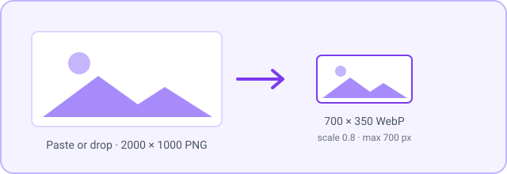
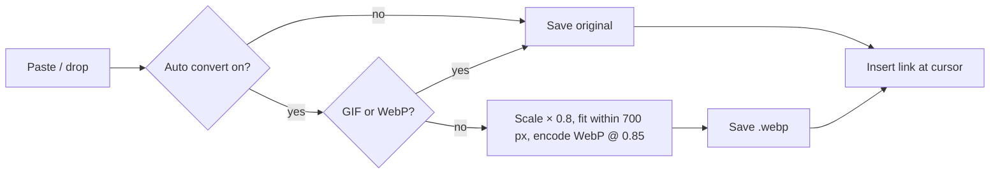

[English](../en/images.md) | **日本語**

# 画像

貼り付けやドロップした画像は、軽量な WebP ファイルとして添付ファイルフォルダーに保存されるので、Vault を小さく保てます。ディスク上の多数の画像を一度に貼り付けることもできます。

[← ドキュメント索引に戻る](README.md)

## 要件

- 外部ツールは不要です。変換は Obsidian 内でローカルに行われます。

## クイックセットアップ

1. スクリーンショットをノートに貼り付けます。デフォルトでは WebP として保存され、80% に縮小され、最大 700 px に収められます。
2. より鮮明な画像にしたい場合は、**Settings → Crystal → Images** で **Image Default Resize Scale** と **Image Max Size** を上げます。
3. 元のファイルのまま保存したい場合は、**Auto Convert Images to WebP on Paste** をオフにします。

## コマンド

| コマンド | 動作 |
|---|---|
| `Image: Paste multiple images from file system` | ファイルダイアログで複数の画像を選びます。画像は添付ファイルフォルダーに保存され（変換がオンなら WebP に変換）、カーソル位置に `![[…]]` リンクとして 1 行ずつ挿入されます。 |

次の処理は自動で行われます。

- **貼り付けとドロップ**: エディターに貼り付けたりドロップしたりした画像は、添付ファイルフォルダーに保存され、カーソル位置にリンクが挿入されます。**Auto Convert Images to WebP on Paste** がオンの場合は、先に変換されます。

## 設定

**Settings → Crystal → Images**

| 設定 | デフォルト | 説明 |
|---|---|---|
| **Auto Convert Images to WebP on Paste** | オン | 貼り付け、ドロップ、複数貼り付けした画像を WebP に変換します。[Gyazo](gyazo.md) へのアップロード前にも同じ変換が適用されます。 |
| **WebP Compression Quality** | 0.85 | 0.1 でファイルサイズが最小、1.0 で画質が最高になります。 |
| **Image Default Resize Scale** | 0.8 | 保存前に各画像を拡大・縮小します（1.0 = 100%）。 |
| **Image Max Size** | 700 | 拡大・縮小後の長辺のピクセル数。これより大きい画像は収まるよう縮小されます。 |

## 使用例

サイズの計算方法: 2000 × 1000 のスクリーンショットは、倍率 0.8 で 1600 × 800 になります。これは 700 px の上限を超えるため、700 × 350 に縮小されます。

## 注意とトラブルシューティング

- **元の画像は残りません。** 保存されるのは変換後の WebP だけです。
- **スクリーンショットの文字がぼやける**: **Image Max Size** を上げ（例: 1920）、**Image Default Resize Scale** を 1.0 にしてください。
- **GIF は変換されない**ので、アニメーションはそのまま動きます。
- 画像は Obsidian の **Settings → Files and links → Default location for new attachments** で設定したフォルダーに保存されます。
- Crystal はウィンドウ全体の貼り付けとドロップを処理します。他の画像プラグインも貼り付けを処理している場合は、どちらかをオフにしてください。
- **プレーンテキストのないリッチテキスト**: クリップボードに HTML だけがある（プレーンテキストがない）場合、Crystal はプレーンテキストとして貼り付けます。
- **複数の画像を一度にドロップした場合**: 処理されるのは最初の 1 枚だけです。まとめて追加するには **Image: Paste multiple images from file system** を使ってください。
