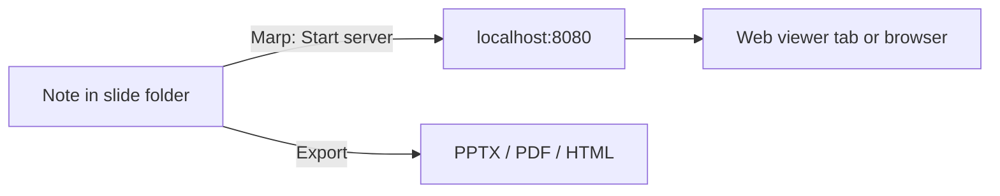

[English](../en/marp.md) | **日本語**

# Marp

Markdown でスライドを書き、[Marp](https://marp.app/) で PPTX、PDF、HTML に変換します。ライブプレビューサーバー、エディター内のツールバー、スライド間を移動するコマンドも含まれています。

[← ドキュメント索引に戻る](README.md)

## 要件

- **Marp CLI**。ログインシェルで `marp` が使えるよう、グローバルにインストールします。
  - `npm i -g @marp-team/marp-cli`、または
  - `pnpm add -g @marp-team/marp-cli`
- PDF と PPTX の書き出しには **Chrome、Edge、Chromium** のいずれか。
- **macOS または Linux** を推奨します。Crystal は CLI ツールをログインシェル経由で実行します。
- 任意: コアプラグインの **Web viewer**。これがあると、プレビューサーバーが Obsidian 内で開き、カーソルの同期が使えます。

## クイックセットアップ

1. Marp CLI をインストールし、ターミナルで `marp -v` が動くことを確認します。
2. **Settings → Crystal → Marp** で **Marp Slide Folder Path (relative path)** を設定します（例: `Slides`）。
3. そのフォルダー内にある、frontmatter が `marp: true` で始まるノートを開きます。
4. **Marp: Start server** を実行するか、フローティングツールバーの再生ボタンを選択します。

## コマンド

| コマンド | 動作 |
|---|---|
| `Marp: Create slide from current note` | **Marp Slide Folder Path (relative path)**（空の場合は現在のノートと同じ場所）に Marp のスライドノートを作成し、新しいタブで開きます。ファイル名と frontmatter は **New slide from note** の設定に従います。2 つのノートはプロパティで相互にリンクされます。 |
| `Marp: Preview slide` | `marp -p` を実行して Marp のプレビューを開きます。ノートと同じ場所に `marp-preview.html` が書き出されます。 |
| `Marp: Export slide (PPTX)` | PPTX ファイルを書き出します。 |
| `Marp: Export slide (PPTX editable)` | テキストを編集できる PPTX ファイルを書き出します。 |
| `Marp: Export slide (HTML)` | 単一の HTML ファイルを書き出します。 |
| `Marp: Export slide (HTML folder with attachments)` | HTML、Markdown のコピー、ローカル画像を含むフォルダーを書き出し、リンクを相対パスに書き換えます。フォルダーはそのまま移動・共有できます。 |
| `Marp: Export slide (PDF)` | PDF ファイルを書き出します。 |
| `Marp: Export presenter notes` | 発表者ノートを `<note>-notes.txt` に書き出します。 |
| `Marp: Start server` | スライドフォルダーの Marp サーバーを `http://localhost:8080` で起動し、現在のスライドを開きます（Web viewer のタブ、またはブラウザー）。Crystal はサーバーを監視し、停止すると通知します。 |
| `Marp: Stop server` | サーバーを停止します。 |
| `Marp: Go to next slide` | カーソルを次のスライドに移動します。 |
| `Marp: Go to previous slide` | カーソルを前のスライドに移動します。 |
| `Marp: Move slide down` | 現在のスライドを次のスライドと入れ替えます。 |
| `Marp: Move slide up` | 現在のスライドを前のスライドと入れ替えます。 |
| `Marp: Move images to Marp folder` | ノートで使われている画像を **Marp Attachment Folder Path** に移動し、リンクを更新します。 |
| `Marp: Move images and convert links to relative paths` | **Move images to Marp folder** を実行したあと、**Editor: Convert links to relative paths** を実行します。 |

書き出し先は **Export Folder Path**（**Settings → Crystal → General**）です。空の場合はノートと同じ場所に保存されます。

## 設定

**Settings → Crystal → Marp**

| 設定 | デフォルト | 説明 |
|---|---|---|
| **Marp Slide Folder Path (relative path)** | （空） | スライドを置くフォルダー。サーバーとツールバーに必要です。 |
| **Marp Theme Directory** | （空） | `marp --theme-set` に渡すディレクトリ。絶対パスでも相対パスでも指定できます。 |
| **Marp Attachment Folder Path** | （空） | **Move images to Marp folder** が画像を置く場所。 |
| **Show slide toolbar** | オン | スライドフォルダー内のノートにフローティングボタンを表示します。前後のスライドへの移動、スライドの上下移動、PPTX/PDF への書き出し、サーバーの起動・停止ができます。 |
| **Move preview slide to cursor** | オフ | サーバーのプレビューがエディターのカーソルに追従します。コアプラグインの **Web viewer** が必要です。 |
| **Move cursor to preview slide** | オフ | エディターのカーソルが、サーバーのプレビューに表示中のスライドに追従します。コアプラグインの **Web viewer** が必要です。 |

**New slide from note**:

| 設定 | デフォルト | 説明 |
|---|---|---|
| **File name prefix** | （空） | 新しいファイル名の先頭に付けるテキスト。 |
| **Date format** | `YYYY-MM-DD` | ファイル名に入れる日付の moment.js 形式。空にすると日付を省きます。 |
| **Separator** | ` `（スペース） | 日付とタイトルの間に入れるテキスト。 |
| **Title source** | File name | **File name**、または **First alias**（なければファイル名を使用）。ファイル名、タイトルスライド、ヘッダーに使われます。 |
| **Theme** | （空） | 新しいスライドの `theme` プロパティ。空にすると省きます。 |
| **Paginate** | オン | `paginate: true` を追加します。 |
| **Header** | （空） | `header` プロパティ。`{{title}}`、`{{date}}`、`{{date:YYYY/MM/DD}}` を使えます。 |
| **Parent note property** | `slide` | 現在のノートで、スライドへのリンクを入れるプロパティ。空にするとスキップします。 |
| **Slide property** | `parents` | スライドで、親ノートへのリンクを入れるプロパティ。空にするとスキップします。 |

**Settings → Crystal → General**

| 設定 | デフォルト | 説明 |
|---|---|---|
| **Export Folder Path** | （空） | 書き出したファイルの保存先。空の場合はノートと同じ場所に保存されます。 |

## 使用例

`Project kickoff.md` でデフォルト設定のまま **Marp: Create slide from current note** を実行すると、`2026-11-10 Project kickoff.md` が作成されます（リンクは Obsidian のリンク形式の設定に従います）。

```markdown
---
marp: true
paginate: true
parents:
  - "[[Project kickoff]]"
---

# Project kickoff
```

同時に、`Project kickoff.md` には `slide: ["[[2026-11-10 Project kickoff]]"]` が追加されます。



## 注意とトラブルシューティング

- **"marp: command not found"**（marp コマンドが見つかりません）: Crystal はログインシェル（`$SHELL`、未設定なら `zsh`）でコマンドを実行します。そのシェルの `PATH` に `marp` があることを確認してください。
- **PDF/PPTX の書き出しに失敗する**: Chrome、Edge、Chromium のいずれかをインストールしてください。
- **ポート 8080 が使用中**:
  - サーバーは常にポート 8080 を使います。
  - すでに別の Marp サーバーがそこで応答している場合、Crystal はそれを再利用します。
  - **Stop server** がポート 8080 のプロセスを停止するのは、それが Marp の場合だけです。
- **ツールバーが表示されない**: **Marp Slide Folder Path (relative path)** を設定し、そのフォルダー内のノートを開いてください。
- **Windows** は十分にサポートされていません。CLI 機能が Unix 系のシェルに依存しているためです。
