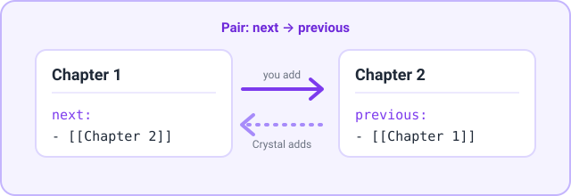

[English](../en/property-link.md) | **日本語**

# プロパティリンク

ノート間のリンクを双方向に保ちます。たとえばノート A の `next` がノート B にリンクしていると、Crystal は B の `previous` プロパティに A へのリンクを追加します。追加するだけで、削除や上書きは一切しません。

[← ドキュメント索引に戻る](README.md)

## 要件

- なし。この機能はデフォルトではオフです。

## クイックセットアップ

1. **Settings → Crystal → Property link** で **Enable Property Link** をオンにします。
2. **Add New Pair** を選択し、ソースに `next`、ターゲットに `previous` を入力します。
3. ノートに `next: ["[[Another note]]"]` を追加します。すると `Another note` に `previous: ["[[This note]]"]` が追加されます。

## コマンド

| コマンド | 動作 |
|---|---|
| `Property link: Sync current note` | アクティブなノートをすべてのペアと照合し、相手側に足りないリンクを追加します。 |
| `Property link: Sync all notes` | Vault 内のすべての Markdown ノートに対して同じ処理を行います。 |

機能がオンの間は、次の処理が自動で行われます。

- ノートのメタデータが変わるたびに、そのペアが同期されます。

## 設定

**Settings → Crystal → Property link**

| 設定 | デフォルト | 説明 |
|---|---|---|
| **Enable Property Link** | オフ | ノートが変更されたときにペアを自動で同期します。ターゲットのプロパティがなければ、リストとして作成されます。 |
| **Add New Pair** | — | ペアの行を追加します。 |
| **Pair *n*** | — | **Source** は監視するプロパティ、**Target** はリンク先のノートで埋めるプロパティです。**-** を選択するとペアを削除します。 |

## 使用例



| ペア | 関係 |
|---|---|
| `next` → `previous` | 一方向。`previous` から `next` への同期も行うには、逆向きのペアを別の行として追加します。 |
| `friends` → `friends` | 対称。両方のノートが互いを列挙します。 |

`Chapter 1.md`:

```yaml
next:
  - "[[Chapter 2]]"
```

保存すると、`Chapter 2.md` に次の内容が追加されます。

```yaml
previous:
  - "[[Chapter 1]]"
```

## 注意とトラブルシューティング

- **解決できないリンクはスキップされます。** まだ存在しないノートへのリンクも含みます。
- **リンクの削除は反映されません。** `next: [[Chapter 2]]` を削除しても、Chapter 2 の `previous` のリンクは自分で削除するまで残ります。同期コマンドを実行しても削除されません。
- 読み書きされるのはリスト形式のプロパティだけです。既存の値は保持され、重複は追加されません。
