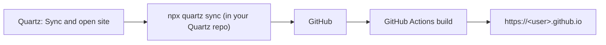

[English](../en/quartz.md) | **日本語**

# Quartz

Obsidian から [Quartz](https://quartz.jzhao.xyz/) サイトを公開します。1 つのコマンドで、ローカルの Quartz リポジトリで `npx quartz sync` を実行し、サイトを開きます。

[← ドキュメント索引に戻る](README.md)

## 要件

- `npx quartz sync` でデプロイできるよう設定済みの、Quartz のローカルクローン。
- ログインシェルで `npx` が使えるよう、Node.js。
- `https://<user>.github.io` の GitHub Pages **ユーザーサイト**。表示用のコマンドは、GitHub のユーザー名からこの URL を組み立てます。

## クイックセットアップ

1. Quartz の[ドキュメント](https://quartz.jzhao.xyz/)に従って Quartz をセットアップし、ターミナルで `npx quartz sync` が動くことを確認します。
2. **Settings → Crystal → Quartz** で次の項目を設定します。
   - **Path to Local Repository of Quartz**（絶対パス）
   - **Quartz Site Name**
   - **Github User Name**
3. コマンド名にサイト名が表示されるよう、Obsidian を再起動します。
4. **Quartz: Sync and open site (…)** を実行します。

## コマンド

| コマンド | 動作 |
|---|---|
| `Quartz: Sync` | `cd "<Quartz path>" && npx quartz sync` を実行します。 |
| `Quartz: Open site (<site name>)` | ブラウザーで `https://<user>.github.io` を開きます。 |
| `Quartz: Sync and open site (<site name>)` | 同期したあと、サイトとリポジトリの GitHub Actions のページを開きます。 |

## 設定

**Settings → Crystal → Quartz**

| 設定 | デフォルト | 説明 |
|---|---|---|
| **Path to Local Repository of Quartz** | （空） | Quartz リポジトリの絶対パス。 |
| **Quartz Site Name** | （空） | コマンド名に表示されます。変更したら Obsidian を再起動してください。 |
| **Github User Name** | （空） | `https://<user>.github.io` と Actions の URL を組み立てるのに使われます。 |

## 使用例

## 注意とトラブルシューティング

- **設定が空だとコマンドは中止されます。**
  - **Path to Local Repository of Quartz** が空だと、同期系のコマンドは "Quartz path is not set"（Quartz のパスが設定されていません）と表示して何もしません。
  - **Github User Name** が空だと、開く系のコマンドは "GitHub user name is not set"（GitHub ユーザー名が設定されていません）と表示して何もしません。**Quartz: Sync and open site** は同期の前に両方を確認します。
- **同期に失敗したとき**:
  - `npx quartz sync` がエラーで終了すると、"Quartz sync failed (exit code …)"（Quartz の同期に失敗しました）と表示され、ページは開きません。
  - 出力は開発者コンソールに書き出されます。ターミナルで同期を実行してエラーを確認することもできます。
  - 同期の成功はプッシュが成功したことだけを意味します。サイトのビルドが通ったかは GitHub Actions のページで確認してください。
- **プロジェクトページと独自ドメイン**（`<user>.github.io` 以外）には、表示用のコマンドは対応していません。
- **コマンド名に `()` と表示される**: **Quartz Site Name** を設定し、Obsidian を再起動してください。
