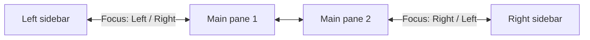

[English](../en/workspace.md) | **日本語**

# ワークスペース

Obsidian のウィンドウそのものに関するツールです。切り替え可能な半透明ウィンドウ、ペイン間やサイドバーへ移動できるフォーカスコマンド、並べ替えや非表示ができるステータスバーを提供します。

[← ドキュメント索引に戻る](README.md)

## 要件

- デスクトップ版 Obsidian。ウィンドウの不透明度はデスクトップのウィンドウ API を使います。

## クイックセットアップ

1. **Settings → Crystal → General** で **Window opacity** を設定します（例: 0.9）。
2. **Window: Toggle opacity**、**Focus: Left**、**Focus: Right** にホットキーを割り当てます。
3. 任意: **Settings → Crystal → Status bar** でステータスバーを整えます。

## コマンド

| コマンド | 動作 |
|---|---|
| `Window: Toggle opacity` | 完全な不透明（1.0）と、最後に使った半透明の値（初回は 0.9）を切り替えます。 |
| `Focus: Left` | 左のペインにフォーカスを移します。メインエリアの端では、そのまま左サイドバーに移ります。右サイドバーからはメインエリアに戻ります。 |
| `Focus: Right` | 同じ動作を右方向に行います。 |

## 設定

**Settings → Crystal → General**

| 設定 | デフォルト | 説明 |
|---|---|---|
| **Window opacity** | 1.0 | Obsidian ウィンドウの不透明度。0.5〜1.0 の範囲です。プラグインを無効にすると 1.0 に戻ります。 |

**Settings → Crystal → Status bar**

| 設定 | デフォルト | 説明 |
|---|---|---|
| 項目リスト | （変更なし） | 検出されたすべてのステータスバー項目。他のプラグインやコア機能の項目も含みます。**↑**/**↓** で並べ替え、目のボタンで表示・非表示を切り替えます。 |
| **Rescan** | — | ステータスバーの項目を再検出します。他のプラグインが読み込まれたあとなどに使います。 |
| **Reset to default** | — | 並び順と非表示の設定をクリアします。 |

## 使用例

フォーカスの移り方:

## 注意とトラブルシューティング

- **ステータスバーの項目がリストにない**:
  - 項目が表示されるのは、それを持つプラグインが読み込まれてからです。Vault が完全に開いてから **Rescan** を選択してください。
  - すでに別の方法（そのプラグイン自身、コアの設定、CSS スニペット）で非表示になっている項目は検出できません。
- **項目に "not loaded" と表示される**（読み込まれていません）: 並び順には保存されていますが、そのプラグインが現在読み込まれていません。
- ウィンドウの不透明度はモバイルでは効果がありません。
